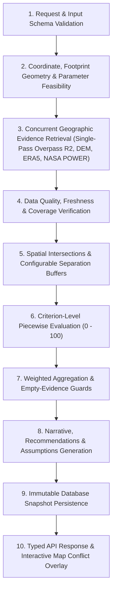

# Analysis Engine Methodology & Criteria Specification — UrjaSetu

## 1. Overview and Core Disclaimer
UrjaSetu performs **multi-criteria decision analysis (MCDA)** to evaluate the spatial suitability of proposed urban infrastructure siting pins.

> [!IMPORTANT]
> **STATUTORY DISCLAIMER**: UrjaSetu is an indicative decision-support system. It **never approves projects**, never claims to represent an official statutory municipal registry, and flags all thresholds and weights as **"NEEDS VERIFICATION"**. Final site clearance requires licensed civil engineering feasibility studies, geotechnical core drilling, and official statutory land-use approvals.

---

## 2. Multi-Criteria Evaluation Pipeline (Engine v1.2.0)
The assessment pipeline executes in ten deterministic stages:

1. **Request Validation**: Validates the placement record, infrastructure type, and parameters.
2. **Coordinate & Geometry Validation**: Validates WGS84 latitude/longitude bounds, derives an oriented rectangular polygon from `(lat, lng, lengthM, widthM, bearingDeg)`, checks polygon ring closure and self-intersection (`turf.kinks`), and verifies parameter-to-area feasibility (e.g., MWp packing density for Solar Farms, bed-to-area ratio for Hospitals).
3. **Concurrent Geographic Evidence Retrieval**: Executes external provider fetches in parallel (`Promise.allSettled`) and retrieves the extended (`R2`) Overpass search ring in a single network call, deriving the primary (`R1`) ring in-memory via geodesic distance filtering.
4. **Data Quality & Coverage Verification**: Evaluates source availability, cache freshness, and OpenStreetMap feature density (`features/km²`). If all external providers are unreachable (`INSUFFICIENT_EVIDENCE`), the engine halts with an actionable `503` error rather than fabricating scores.
5. **Spatial Intersections & Configurable Separation Buffers**: Computes direct polygon intersections and footprint-perimeter-to-feature geodesic distances (`computeFootprintDistanceToGeometryMeters`) against per-infrastructure separation thresholds (`INFRASTRUCTURE_SEPARATION_RULES` grounded in NBC India, IRC, CPCB, and CEA norms).
6. **Criterion-Level Piecewise Evaluation**: Normalizes raw physical metrics to a 0–100 scale. When OpenStreetMap returns zero features (`osmEmpty`), OSM-dependent criteria are marked `unavailable` (`null` score) so unmapped areas are never mistaken for optimal service gaps or zero-building corridors.
7. **Weighted Aggregation & Penalty**: Aggregates verified criteria weights ($\sum w_i = 1.0$). If critical footprint conflicts occur, the overall score is clamped to maximum 24/100 ("Unsuitable"). When OSM returns zero features, overall confidence is capped at $\le 35\%$.
8. **Narrative, Recommendations & Assumptions**: Generates transparent supporting factors, risks, mitigation recommendations, calculation assumptions, and evidence citations (`[E1]..[En]`).
9. **Snapshot Persistence**: Saves the immutable report JSON in Prisma (`Analysis` table).
10. **Structured Response & Map Overlay**: Returns the typed `AnalysisReportResult` and renders conflicting OSM geometries (red for critical overlaps, amber for setback warnings) directly on the MapLibre canvas.

---

## 3. Suitability Bands & Score Classification

| Score Range | Suitability Band | Planning Tone | Meaning |
| :--- | :--- | :--- | :--- |
| **78 – 100** | **High Suitability** | Positive | Indicative metrics strongly support siting under standard heuristic criteria. |
| **58 – 77** | **Moderate Suitability** | Moderate | Viable baseline conditions with manageable localized constraints requiring engineering mitigation. |
| **40 – 57** | **Low Suitability** | Cautious | Multiple siting constraints observed; demands civil intervention or land clearance. |
| **25 – 39** | **Highly Constrained** | Cautious | Severe spatial, accessibility, or terrain barriers identified. Not recommended without redesign. |
| **0 – 24** | **Unsuitable** | Negative | Critical conflicting land uses or physical hazards prohibit viable siting. |

---

## 4. Complete Criteria Catalog by Infrastructure Type

### 4.1 Hospital
- **Arterial Road Proximity** (Weight: 0.20, Provider: Overpass):
  - $\le 60\text{ m}$: 100 | $\le 150\text{ m}$: 88 | $\le 350\text{ m}$: 72 | $\le 700\text{ m}$: 50 | $> 700\text{ m}$: 30
  - *Benchmark: Distance to primary/secondary road < 400m (NEEDS VERIFICATION)*
- **Healthcare Service Gap** (Weight: 0.20, Provider: Overpass):
  - Existing hospitals in 3 km: 0 = 98 (critical gap) | 1 = 85 | 2 = 65 | $\ge 3$ = 35 (saturated)
  - *Benchmark: Underserved regional medical need (NEEDS VERIFICATION)*
- **Residential Catchment Proxy** (Weight: 0.20, Provider: Overpass):
  - Residential structures in 1 km: $\ge 180$ = 96 | $\ge 90$ = 84 | $\ge 35$ = 68 | $< 10$ = 25
  - *Benchmark: Surrounding residential density within 1km (NEEDS VERIFICATION)*
- **Noise & Industrial Buffer** (Weight: 0.15, Provider: Overpass):
  - Setback from rail/heavy industry: $> 300\text{ m}$ = 95 | $\le 200\text{ m}$ = 40
  - *Benchmark: Distance to railway or industrial noise > 250m (NEEDS VERIFICATION)*
- **Terrain Slope** (Weight: 0.15, Provider: Open-Meteo):
  - Ground slope: $\le 3\%$ = 98 | $\le 5\%$ = 85 | $\le 8\%$ = 68 | $> 8\%$ = 30
  - *Benchmark: Slope < 5% preferred for multi-acre campus foundation (NEEDS VERIFICATION)*
- **OSM Data Density Confidence** (Weight: 0.10, Provider: Overpass):
  - Feature density: $\ge 25/\text{km}^2$ = 98 | $\ge 12$ = 85 | $< 3$ = 20

---

### 4.2 School
- **Residential Family Density** (Weight: 0.25): High residential count in 1 km walkshed. *(NEEDS VERIFICATION)*
- **High-Speed Traffic Safety Buffer** (Weight: 0.20): Distance to motorway/trunk $> 150\text{ m}$. *(NEEDS VERIFICATION)*
- **School Supply Gap** (Weight: 0.20): Sparse schools within 1 km walking radius indicates high need. *(NEEDS VERIFICATION)*
- **Park & Recreation Proximity** (Weight: 0.15): Distance to park/garden $< 600\text{ m}$. *(NEEDS VERIFICATION)*
- **Site Slope & Accessibility** (Weight: 0.10): Slope $< 4\%$ for universal accessibility. *(NEEDS VERIFICATION)*
- **OSM Data Density Confidence** (Weight: 0.10): Baseline data verification. *(NEEDS VERIFICATION)*

---

### 4.3 Park
- **Green Space Deficit** (Weight: 0.30): Siting fills critical neighborhood park shortage. *(NEEDS VERIFICATION)*
- **Accessible Citizen Catchment** (Weight: 0.25): Surrounding residential density in 800 m. *(NEEDS VERIFICATION)*
- **Waterway Synergy** (Weight: 0.15): Proximity to stream/canal $< 500\text{ m}$ supports biodiversity. *(NEEDS VERIFICATION)*
- **Pedestrian & Street Access** (Weight: 0.15): Walkable street access $< 100\text{ m}$. *(NEEDS VERIFICATION)*
- **Topographic Suitability** (Weight: 0.05): Slope $< 8\%$ for active trails. *(NEEDS VERIFICATION)*
- **OSM Data Density Confidence** (Weight: 0.10). *(NEEDS VERIFICATION)*

---

### 4.4 Road
- **Highway Network Connectivity** (Weight: 0.30): Intersects classified roads at corridor endpoints. *(NEEDS VERIFICATION)*
- **Right-of-Way Clearance** (Weight: 0.25): Zero building displacements along corridor. *(NEEDS VERIFICATION)*
- **Crossings Count** (Weight: 0.15): Waterway and rail intersections requiring grade separation. *(NEEDS VERIFICATION)*
- **Longitudinal Gradient** (Weight: 0.20): Slope $< 6\%$ for heavy vehicle traction. *(NEEDS VERIFICATION)*
- **OSM Data Density Confidence** (Weight: 0.10). *(NEEDS VERIFICATION)*

---

### 4.5 Bridge
- **Target Barrier Intersection** (Weight: 0.30): Traverses uncrossed waterway or rail barrier. *(NEEDS VERIFICATION)*
- **Approach Road Alignment** (Weight: 0.25): Connects to public roads on both approaches. *(NEEDS VERIFICATION)*
- **Crossing Scarcity** (Weight: 0.15): Distance to nearest existing bridge $> 800\text{ m}$. *(NEEDS VERIFICATION)*
- **Abutment Clearance** (Weight: 0.15): Building clearance in landing zones. *(NEEDS VERIFICATION)*
- **Elevation Profile** (Weight: 0.05): Foundation height above local depression. *(NEEDS VERIFICATION)*
- **OSM Data Density Confidence** (Weight: 0.10). *(NEEDS VERIFICATION)*

---

### 4.6 Water Canal
- **Gravity Slope Suitability** (Weight: 0.30): Slope $0.05\% - 2.0\%$ for gravity flow without scour. *(NEEDS VERIFICATION)*
- **Outfall / Source Link** (Weight: 0.25): Proximity to natural receiving river or lake. *(NEEDS VERIFICATION)*
- **Corridor Structure Encroachment** (Weight: 0.20): Clearance of existing buildings. *(NEEDS VERIFICATION)*
- **Roadway Crossing Feasibility** (Weight: 0.15): Siphon/culvert crossing count. *(NEEDS VERIFICATION)*
- **OSM Data Density Confidence** (Weight: 0.10). *(NEEDS VERIFICATION)*

---

### 4.7 Building
- **Road Access & Frontage** (Weight: 0.25): Vehicular street frontage $< 50\text{ m}$. *(NEEDS VERIFICATION)*
- **Land-Use Compatibility** (Weight: 0.25): Compatible urban fabric free of heavy industrial conflicts. *(NEEDS VERIFICATION)*
- **Utility & Power Proximity** (Weight: 0.20): Distance to electrical power grid $< 500\text{ m}$. *(NEEDS VERIFICATION)*
- **Slope & Foundation Stability** (Weight: 0.15): Slope $< 6\%$ reduces shoring and excavation. *(NEEDS VERIFICATION)*
- **OSM Data Density Confidence** (Weight: 0.15). *(NEEDS VERIFICATION)*

---

### 4.8 Transit Station
- **Dense Walking Catchment (800m)** (Weight: 0.30): High residential/commercial density in 10-min walkshed. *(NEEDS VERIFICATION)*
- **Intermodal Network Links** (Weight: 0.25): Feeder bus stops and rail connections $< 400\text{ m}$. *(NEEDS VERIFICATION)*
- **Arterial Street Integration** (Weight: 0.20): Direct access to secondary or primary road. *(NEEDS VERIFICATION)*
- **Station Spacing Optimization** (Weight: 0.15): Separation from existing stations $> 500\text{ m}$. *(NEEDS VERIFICATION)*
- **OSM Data Density Confidence** (Weight: 0.10). *(NEEDS VERIFICATION)*

---

### 4.9 Drainage
- **Natural Low-Point Alignment** (Weight: 0.25): Siting in topographic valley depression. *(NEEDS VERIFICATION)*
- **Receiving Outfall Distance** (Weight: 0.25): Distance to river/canal outfall $< 500\text{ m}$. *(NEEDS VERIFICATION)*
- **Catchment Impervious Surface Ratio** (Weight: 0.20): Building and road density generating runoff. *(NEEDS VERIFICATION)*
- **Indicative Manning Hydraulic Check** (Weight: 0.15):
  $$Q = \frac{1}{n} A R_h^{2/3} S^{1/2}$$
  Where $n=0.015$ (concrete lined), $A = \text{width} \times 0.75\text{depth}$, $S = \max(\text{slope}, 0.001)$.
  Ratio $Q_{\text{capacity}} / Q_{\text{design}} \ge 1.0$ satisfies peak inflow. *(NEEDS VERIFICATION)*
- **Historical Rainfall Intensity** (Weight: 0.05): Peak 24-hr daily rainfall from Open-Meteo ERA5-Land. *(NEEDS VERIFICATION)*
- **OSM Data Density Confidence** (Weight: 0.10). *(NEEDS VERIFICATION)*

---

### 4.10 Solar Farm
- **Solar Resource (GHI)** (Weight: 0.30): Annual average Global Horizontal Irradiance from NASA POWER $> 4.5\text{ kWh/m}^2/\text{day}$. *(NEEDS VERIFICATION)*
- **Grid Interconnection Proximity** (Weight: 0.25): Distance to electrical power line/substation $< 1500\text{ m}$. *(NEEDS VERIFICATION)*
- **Terrain Slope & Flatness** (Weight: 0.20): Slope $< 5\%$ minimizes racking earthwork and self-shading. *(NEEDS VERIFICATION)*
- **Heavy Equipment Delivery Access** (Weight: 0.10): Road access $< 500\text{ m}$ for transformer delivery. *(NEEDS VERIFICATION)*
- **Shading Obstruction Buffer** (Weight: 0.05): Setback from dense tall forest or high-rise clusters. *(NEEDS VERIFICATION)*
- **OSM Data Density Confidence** (Weight: 0.10). *(NEEDS VERIFICATION)*
