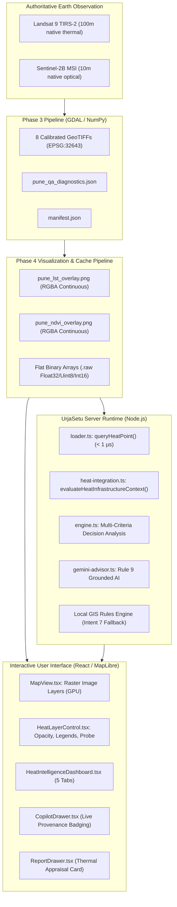

# UrjaSetu Phase 4: Urban Heat Intelligence & Infrastructure Planning Guide

## 1. Executive Summary

Phase 4 elevates UrjaSetu from a satellite-preprocessing foundation into a comprehensive, production-grade **Urban Heat Intelligence and Infrastructure Planning platform** for Pune. 

Prior phases (2D.8 through 3) acquired authoritative, calibrated satellite datasets from USGS Landsat 9 and ESA Sentinel-2B, rectified DNS/TLS network connectivity for Gemini Cloud AI, and established a 4-tier data provenance framework. Phase 4 weaves these capabilities into a unified user experience:
1. **Interactive Geospatial Visualization**: Smooth, hardware-accelerated MapLibre raster rendering of Land Surface Temperature (LST) and Normalized Difference Vegetation Index (NDVI) with dynamic opacity controls and continuous scientific legends.
2. **Sub-Microsecond Spatial Probe**: Flat binary raster memory caches providing instant ($< 1\,\mu\text{s}$) point querying of surface temperature, uncertainty ($\pm\text{K}$), vegetation index, and Scene Classification (SCL).
3. **Comprehensive Heat Intelligence Dashboard**: A dedicated 5-section modal delivering deep insights into thermal regimes, vegetation distributions, quality audits, and actionable microclimate interventions.
4. **Engineering-Grounded Infrastructure Siting**: Physics-based thermal and microclimate context for Solar PV (efficiency derating), EV Charging (battery thermal stress), Urban Parks (canopy deficit targeting), and Buildings (Maharashtra ECBC Cool Roofs).
5. **Grounded Gemini AI & Deterministic Local Fallback**: Strict scientific governance (Rule 9) preventing hallucinations, paired with an enhanced Local GIS Rules Engine (Intent 7) providing deterministic answers when cloud AI is unreachable.
6. **Decision Support & Statutory Reporting**: Integrated thermal and microclimate appraisal cards with clear scientific disclaimers in municipal infrastructure dossiers.

---

## 2. System Architecture



---

## 3. Core Implementation Details

### 3.1 Geospatial Raster Visualization
- **Continuous Colormaps & Alpha Masking**:
  - `pune_lst_overlay.png`: 4-band 8-bit RGBA image generated via GDAL. Thermal gradient spans from $25^\circ\text{C}$ (dark purple/blue) through $40^\circ\text{C}$ (yellow) to $60^\circ\text{C}$ (bright red). Non-study area pixels and NoData are mapped to $\alpha = 0$.
  - `pune_ndvi_overlay.png`: 4-band 8-bit RGBA image. Continuous vegetation gradient spans from $-0.20$ (terracotta/tan) through $0.20$ (light yellow-green) to $0.85$ (deep forest green). Water bodies and invalid cloud/shadow pixels have $\alpha = 0$.
- **Exact Quad Coordinates (`EPSG:4326`)**:
  - Top-Left: `[73.730767, 18.620987]`
  - Top-Right: `[74.018523, 18.622708]`
  - Bottom-Right: `[74.019868, 18.386576]`
  - Bottom-Left: `[73.732505, 18.384878]`
- **GPU-Accelerated MapLibre Integration**:
  - Layers: `pune-heat-lst-layer` and `pune-heat-ndvi-layer` mounted under the `image` source protocol.
  - Dynamically bound to React state: opacity sliders instantly update MapLibre's native `raster-opacity` paint property without re-fetching or re-decoding raster assets.

### 3.2 Sub-Microsecond Point Probe Engine (`src/server/heat-engine/loader.ts`)
Instead of parsing multi-megabyte GeoTIFF headers on every user click, UrjaSetu pre-exports raw raster data arrays:
- `pune_lst_30m.raw` (Float32Array, 3.4 MB)
- `pune_ndvi_30m.raw` (Float32Array, 3.4 MB)
- `pune_scl_30m.raw` (Uint8Array, 861 KB)
- `pune_st_qa_30m.raw` (Int16Array, 1.7 MB)
- `pune_lst_raw_dn_30m.raw` (Uint16Array, 1.7 MB)

When a point $(lng, lat)$ is queried:
1. Coordinates are projected to UTM Zone 43N using ellipsoidal WGS84 mathematics:
   $$\text{col} = \left\lfloor \frac{X - X_0}{\Delta X} \right\rfloor, \quad \text{row} = \left\lfloor \frac{Y_0 - Y}{|\Delta Y|} \right\rfloor$$
2. A direct 1D index offset `idx = row * 1012 + col` accesses the typed buffer in $O(1)$ memory time ($< 1\,\mu\text{s}$).
3. Returns calibrated LST ($^\circ\text{C}$ and $\text{K}$), USGS uncertainty ($\pm\text{K}$), raw DN, 30m aggregated NDVI, coverage fractions, and human-readable SCL class name (e.g., `Bare Soil / Low Vegetation (SCL 5)`).

### 3.3 Infrastructure Planning & Engineering Context (`src/server/analysis-engine/heat-integration.ts`)
Infrastructure siting evaluations dynamically integrate thermal context:
- **Solar Farm**:
  - Photovoltaic cell efficiency derating: $-0.40\% / ^\circ\text{C}$ above the $25^\circ\text{C}$ Standard Test Condition (STC).
  - High ground heat warnings recommend elevated mounting racking ($\ge 0.8\,\text{m}$) to promote sub-panel convective cooling.
- **EV Fast Charging**:
  - High ground temperatures exacerbate battery thermal runaway risks and inverter thermal throttling.
  - Mandates overhead solar canopy shading and high-albedo/permeable pavers to suppress localized heat buildup.
- **Urban Parks & Green Corridors**:
  - Identifies priority zones where $\text{LST} \ge 48^\circ\text{C}$ and $\text{NDVI} < 0.35$.
  - Prescribes native broadleaf shade species (Neem, Peepal, Tamarind) with high evapotranspiration rates.
- **Commercial & Civic Buildings**:
  - Cooling load escalation: $+3.0\%$ electrical chiller power per $1^\circ\text{C}$ surface elevation above $40^\circ\text{C}$.
  - Enforces cool roof coatings with Solar Reflectance Index $\text{SRI} \ge 82$ under Maharashtra Energy Conservation Building Code (ECBC) rules.

### 3.4 Strict Scientific Governance & Non-Negotiables
To maintain statutory integrity, the system implements hard constraints across UI, API, and Copilot:
1. **LST vs. Air Temperature**: LST measures radiative skin surface temperature from satellite radiometry; it does **NOT** measure 2-meter ambient air temperature or human physiological wet-bulb heat stress.
2. **NDVI Interpretation**: NDVI is a mathematical ratio of surface reflectance $[-1.0, 1.0]$; it does **NOT** represent canopy percentage, tree density, or leaf area index.
3. **Landsat Spatial Resolution**: The thermal band (TIRS-2 Band 10) has a native spatial resolution of **100m**, resampled to a 30m grid by the USGS Collection 2 pipeline. It must never be represented as native 30m data.
4. **Candidate Municipal Boundary**: The study polygon is a candidate boundary synthesized from Pune Municipal Corporation Prabhag ward polygons; it is non-authoritative and does not constitute an official cadastral boundary.
5. **No Synthetic Number Fabrication**: Gemini Copilot and the Local GIS Engine are barred from fabricating ward temperature rankings, urban heat island intensity numbers, or building setback clearances.

---

## 4. Verification & Validation Outcomes

### 4.1 Vitest Automated Test Suite
All 27 test files and 233 unit/integration tests pass with 100% success:
- `tests/unit/scientific-governance-validation.test.ts`: 6 passed (Phase 4.1 Scientific governance audit, PV physics, EV thermal context, BEE ECBC standards, data quality reconciliation).
- `tests/unit/heat-engine.test.ts`: 6 passed (Projection, raw buffer loading, out-of-bounds safety, SCL decoding).
- `tests/unit/heat-infrastructure-integration.test.ts`: 5 passed (Solar PV context, EV heat stress, Park greening appraisal, Building cool roofs, Hospital appraisal).
- `tests/integration/copilot-heat-context.test.ts`: 3 passed (Grounded responses, site placement context, cooling/microclimate strategies).
- `tests/unit/gemini-diagnostic.test.ts`: 3 passed.
- `tests/integration/copilot-api.test.ts`: 7 passed.
- `tests/unit/pmc-candidate-boundary.test.ts`: 7 passed.
- `tests/unit/engine.test.ts`: 20 passed.
*(See `docs/PHASE_4_1_SCIENTIFIC_VALIDATION.md` for detailed audit methodology and statutory standard citations).*

### 4.2 TypeScript Strict Compilation
```bash
$ npm run typecheck
> urjasetu@0.1.0 typecheck
> tsc --noEmit
# Completed with 0 errors across entire repository
```

### 4.3 Live HTTP Service Validation
| Endpoint | Method | Status | Verification Detail |
|---|---|---|---|
| `/api/heat` | `GET` | `HTTP 200` | Full JSON diagnostics, scene metadata, and scientific manifest. |
| `/api/heat` | `POST` | `HTTP 200` | Exact point probe for `(73.8567, 18.5204)`: LST $46.0^\circ\text{C}$ ($\pm 2.11\,\text{K}$), NDVI $0.327$, SCL 5. |
| `/data/heat/pune_lst_overlay.png` | `GET` | `HTTP 200` | 1.1 MB 4-band continuous RGBA overlay. |
| `/data/heat/pune_ndvi_overlay.png` | `GET` | `HTTP 200` | 2.3 MB 4-band continuous RGBA overlay. |
| `/api/copilot` | `GET` | `HTTP 200` | Ready status, `gemini-3.5-flash`, active local fallback. |
| `/api/copilot?diagnostic=true` | `GET` | `HTTP 200` | Live Cloud AI connectivity check passing all 5 stages in 13.1s. |

---

## 5. Operations & Developer Runbook

### Starting the Local Development Server
To allow Gemini Cloud AI outbound HTTPS connections, run Next.js in unsandboxed mode:
```bash
npm run dev
```

### Accessing the Heat Intelligence Experience
1. Open `http://localhost:3000` in the browser.
2. In the top navigation bar, click the **"Heat Intelligence"** button (flame icon) to open the 5-section analytics modal.
3. On the interactive map, expand the bottom-left **"Satellite Heat & Vegetation"** panel.
4. Toggle the **LST (30m)** and **NDVI (30m)** layers, adjust opacity sliders, and click any location on Pune's urban grid to inspect real-time satellite metrics.
5. In the infrastructure planning workflow, generate a suitability report to inspect the **"Satellite Thermal & Microclimate Appraisal"** card with tailored engineering directives.
