# UrjaSetu Redesign & Verification Ledger
**Living Record of Architecture Decisions, Verification Runs, and Progression**
*Project: UrjaSetu Autonomous Product Redesign, UX Unification & Verification*
*Author: Senior Engineering & Product-Design Autonomous Agent Team*
*Created: November 5, 2026*

---

## 1. Baseline System Report (Phase 0)

All baseline tests were executed directly in the repository environment before making any code modifications.

### 1.1 Technical Checks Baseline

| Check | Command | Baseline Status | Details / Diagnostic Summary |
| :--- | :--- | :--- | :--- |
| **Type-check** | `npm run typecheck` (`tsc --noEmit`) | **PASS** (Code 0) | Clean. Zero TypeScript errors across entire `src/` and `tests/`. |
| **Linter** | `npm run lint` (`next lint`) | **PASS with 6 Warnings** (Code 0) | 6 `react-hooks/exhaustive-deps` warnings: in `MapView.tsx`, `HeatPriorityScreen.tsx` (lines 163, 246, 476), `ScenarioComparisonModal.tsx`, `ShadowSimulatorModal.tsx`, and `SolarRealityModal.tsx`. |
| **Automated Test Suite** | `npm run test` (`vitest run`) | **PASS** (Code 0) | **48 test files passed (48/48)**, **341 unit & integration tests passed (341/341)**. Duration: ~18.35s. |
| **Production Build** | `npm run build` (`prisma generate && next build`) | **PASS** (Code 0 after cache clean) | Prisma client generated successfully. When `.next` cache is clean, all 19 app & API routes compiled and generated statically/dynamically with 0 errors. Stale `.next` build cache previously reported an ENOENT on deleted routes, resolved by clearing `.next`. |

### 1.2 Component Tree & State Flow Mapping

```mermaid
graph TD
    A["src/app/page.tsx (HomePage)"] --> B["src/components/layout/MainWorkspace.tsx"]
    B -->|"viewMode === 'priority' (Default)"| C["src/components/priority/HeatPriorityScreen.tsx"]
    B -->|"viewMode === 'legacy_siting'"| D["src/components/layout/AppShell.tsx"]
    
    subgraph "Current Priority System (Dark Theme)"
        C --> C1["MapLibre Canvas (250m Priority Cells Fill/Line)"]
        C --> C2["Left Scenario Optimizer Panel (Ha Slider, NDVI, Objective, Ward)"]
        C --> C3["Top Bar (Legend, Ward dropdown, Legacy Tools menu, Compare, /method)"]
        C --> C4["Bottom Strip (Portfolio Summary Ha/Cooling/Pop)"]
        C --> C5["ZoneEvidenceDrawer (Slide-over cell detail)"]
        C --> C6["TwoScenarioComparisonModal"]
        C -->|"Legacy Tools Menu"| C7["Hidden Modals: Shadow, Solar Reality, Interventions, Copilot, Siting"]
    end

    subgraph "Current Siting System (Light Theme Floating Cards)"
        D --> D1["TopBar (Search, Scenario/City, Compare, Reports, Copilot)"]
        D --> D2["ToolSidebar (11 Infra Types: Civic, Transport, Utilities, Energy)"]
        D --> D3["MapView (MapLibre with 3D buildings, DEM, POIs, Boundaries)"]
        D --> D4["PlacementPanel (Properties, Parameters, Smart-Fit, Bridge crossing)"]
        D --> D5["ReportDrawer (Analysis score breakdown, PDF export)"]
        D --> D6["Modals (ShadowSimulatorModal, SolarRealityModal, ScenarioComparisonModal)"]
    end
```

### 1.3 Audit Discrepancy List (Audit Claims vs Real Codebase)

| Item | Audit Claim | Verified Codebase Reality | Architectural Impact |
| :--- | :--- | :--- | :--- |
| **1. 250m Priority Cells Count** | "Grid of roughly 250 m cells over Pune (about 4,964 active)" | `public/data/priority/cells.json` contains exactly **42** curated 250m priority cells spanning major Pune municipal wards (Kasba Vishrambaugwada, Shivajinagar, Bhavani Peth, etc.). | Must not fabricate extra cells; render the authentic 42 cells and their exact computed values. |
| **2. Multi-City Data Coverage** | "parameterised for Pune Municipal Corporation (PMC), with partial or placeholder extensions for Pimpri-Chinchwad (PCMC) and Nashik (NMC)" | Siting workspace has authentic snapshots, MSEDCL substations, POIs, and boundaries for PMC, PCMC, and NMC in `src/data/`. However, **Heat Priority & Cooling Optimizer (250m cells)** is strictly for Pune (PMC); no cells exist for PCMC or NMC in `cells.json`. | The unified shell will clearly indicate Pune as the active Heat & Cooling intelligence area, while allowing Siting Studio to explore PMC/PCMC/NMC with clear data availability indicators. |
| **3. Budget-to-Rupee Logic** | "Budget presets in rupees may appear ONLY if the repository already contains a cost-per-hectare assumption" | Inspection of `src/server/priority/optimizer.ts`, `scoring.ts`, and `weight-profiles.ts` confirms **zero rupee-per-hectare assumption exists**. The priority engine operates strictly on `budget_ha` (hectares). | Strictly adhere to Section 2 rule: Presets must be hectare-based with municipal scope labels (e.g. "Micro-Pocket: 5 ha", "Ward Standard: 10 ha", "Priority Corridor: 25 ha", "City Scale: 50 ha"). No invented rupee numbers. |
| **4. Cryptographic Claims in PDF** | Audit warned against false cryptographic claims | Checked `generate-zone-dossier-pdf.ts`, `generate-report-pdf.ts`, and `generate-scenario-comparison-pdf.ts`. No claims of "cryptographic" or "tamper-proof" exist. Generated PDFs state authentic generation timestamps and scene dates. | Retain truthful provenance wording; ensure UI and PDF text explicitly cite Landsat-9 and Sentinel-2 acquisition dates without unverifiable claims. |
| **5. AI Copilot Execution & Key** | Audit questioned if Copilot works without key | `.env` has a configured `GEMINI_API_KEY` and `GEMINI_MODEL="gemini-3.5-flash"`. In `POST /api/copilot`, missing API key triggers a graceful 503 `KEY_NOT_CONFIGURED` or falls back to local deterministic GIS rules if `fallbackToLocal: true`. | Ensure graceful error handling and local fallback options in UI so Copilot never hangs or crashes even if external API limits are exceeded. |
| **6. Typography & Contrast** | Small fonts under 11px noted in audit | Confirmed: `ProvenanceTag.tsx` uses `text-[9px]`, headers use `text-[10px]`, map legends use 10px. | Upgrade all typography to a minimum of 11px (data tags) and 14px (body), with WCAG AA compliant contrast. |
| **7. "Legacy Tools" Menu** | Legacy menu hides siting, shadow simulator, copilot | Confirmed: Siting, Solar Reality, Shadow Simulator, Interventions, and Copilot are buried inside an ambiguous `Legacy tools` dropdown in `HeatPriorityScreen.tsx`. | Completely remove "Legacy tools" menu and surface all capabilities into a unified left navigation rail with consistent design language. |

---

## 2. Redesign Implementation Plan

### Phase 1: Design System & Design Tokens
- Implement unified design tokens in `src/app/globals.css` and `tailwind.config.ts`.
- Deep slate government/climate theme (`slate-950` base, `slate-900` surfaces, `slate-800` cards, `emerald-500` accents).
- Establish typography scale: minimum font size >= 11px (nothing under 11px anywhere), body >= 14px, tabular numerals (`font-mono`) for metrics.
- Create unified UI primitives:
  - Accessible `ProvenanceTag` with semantic icons (Activity for Measured, Cpu for Modelled, Sliders for Assumed) and WCAG AA contrast.
  - Reusable `Tooltip` and `GlossaryTerm` component for plain-language definitions (LST, NDVI, NDBI, Heat Burden, Derating).
  - Standardized Button, Card, Panel, Badge, and StatCard components.

### Phase 2: Unified Shell & Navigation
- Build `src/components/layout/UnifiedShell.tsx` replacing the binary `viewMode` toggle.
- Create persistent Left Navigation Rail (collapsible, icon + label, active indicators, keyboard accessible):
  1. **City Overview / Executive Dashboard** (`overview`)
  2. **Heat Burden & Cooling Optimizer** (`heat_priority`)
  3. **Green Loss Watch** (`green_loss`)
  4. **Infrastructure Siting Studio** (`siting` - with all 11 types)
  5. **Solar Shadow Simulator** (`shadow_sim`)
  6. **Solar Heat Derating & Reality** (`solar_reality`)
  7. **Reports & Dossiers** (`reports`)
  8. **Scientific Methodology & Model Card** (`methodology`)
- Slim executive Top Bar:
  - UrjaSetu branding + Pune Municipal Corporation jurisdiction badge.
  - Quick Ward selector with fly-to.
  - Universal Compare button (triggers scenario comparison).
  - Universal Export Report button.
  - Universal AI Copilot toggle (`⌘J`).
  - Universal Provenance Legend pill.
- Eliminate "Legacy tools" menu entirely.

### Phase 3: GIS & Climate Intelligence Experience
- Simplify map controls into grouped, high-contrast, accessible controls (Zoom, Reset View, Basemap toggle, Layer toggle).
- Streamline layer selection: default to primary layer ("Heat Stress & Burden"), with secondary layers (LST, NDVI, Population, Green Loss, Solar Penalty) organized cleanly under an "All Layers" panel.
- Enhanced map legend: minimum 12px text, units clearly labeled, provenance tag attached, colorblind-safe Viridis ramp preserved.
- Interactive hover and click cards with context-aware metrics.

### Phase 4: Cooling Optimizer & Green Loss Workflows
- Optimizer enhancements:
  - Budget presets chips: "Micro-Pocket (5 ha)", "Ward Standard (10 ha)", "Priority Corridor (25 ha)", "City Sector (50 ha)" + fine-tune slider under collapsible panel.
  - Canopy target options: "Light Canopy (0.45 NDVI)", "Moderate Shading (0.55 NDVI)", "Dense Canopy (0.65 NDVI)", "Urban Park / Forest (0.75 NDVI)" with raw NDVI slider available in Advanced view.
  - Plain-language result summaries ("Allocating 10.0 ha achieves an average 2.26°C cooling benefit across 42 priority cells, directly protecting 45,200 residents").
  - Clear before/after visualization.
- Green Loss Watch:
  - Plain-language headline: "23 Pune Wards Monitored: Significant Canopy Reductions Detected (2019 vs 2026)".
  - Ranked ward table with severity indicators.
  - Direct "Plan Restoration Here" action that pre-filters the Optimizer to the selected ward.
  - Clear scientific disclaimer on satellite change detection and need for municipal cadastre/field survey.

### Phase 5: Infrastructure Siting Integration
- Bring Siting Studio into the unified dark-slate theme:
  - Move ToolSidebar into categorized groups: Civic Amenities, Transport & Corridors, Utilities, Clean Energy.
  - Harmonize PlacementPanel and MapView with the new design tokens.
  - Retain all 11 infrastructure types, Smart-Fit constraint validation, 2-click linear drawing (roads, bridges, canals), and 3D solar shadow engine.
  - Clear pass/fail constraint badges with corrective action guidance.

### Phase 6: AI Copilot & Evidence Experience
- Persistent side-drawer AI Decision Copilot accessible across all views via top bar and contextual action triggers ("Ask Copilot about this ward", "Explain cooling variance", "Verify setback").
- Suggested starter questions grounded in active context.
- Rigorous verification gate: tool calls (`get_zone`, `run_optimization`, `check_constraints`) execute deterministically, numbers are flagged with provenance.
- Evidence Drawer revamp: lead with 3 key numbers, followed by satellite scene manifests, uncertainty bounds (p10-p90), and model card links.
- Report discovery: direct report download and export options.

### Phase 7: Responsive Layout & Accessibility Audit
- Responsive breakpoints tested at 1920px, 1440px, 1024px, 768px, and 390px (mobile).
- Collapsible navigation rail to bottom sheet or compact hamburger on mobile.
- Full keyboard navigation (`Tab`, `Shift+Tab`, `Enter`, `Escape`, `⌘J`, `⌘K`).
- Strict WCAG AA contrast check and no text rendered below 11px.

### Phase 8: Regression Testing & Final Validation
- Full test suite run (`npm run test`).
- Full type-check run (`npm run typecheck`).
- Full production build (`npm run build`).
- API contract verification before/after for `/api/optimize`, `/api/zone/[id]`, `/api/green-loss`, `/api/model-card`, `/api/copilot`.

---

## 3. Living Ledger & Status Tracking

### 3.1 Completed Improvements
- [x] **Phase 0: Baseline System Inspection**
  - Baseline type-check verified (0 errors).
  - Baseline linter verified (0 errors, 6 standard react-hooks warnings).
  - Baseline vitest verified (48/48 test files, 341/341 tests passing).
  - Baseline production build verified clean (19/19 routes compiled).
  - Real dataset verified (42 priority cells, PMC active, 0 rupee assumptions).
- [x] **Phase 1: Design System & Design Tokens**
  - Modernized `src/app/globals.css` with dark-slate government tokens (`#090d16` base, `#0f172a` surfaces, `#1e293b` borders, high-contrast MapLibre popups, accessible scrollbars).
  - Upgraded `src/components/ui/ProvenanceTag.tsx`: added semantic Lucide icons (`Activity` for Measured, `Cpu` for Modelled, `SlidersHorizontal` for Assumed), enforced `text-[11px]` minimum font size and WCAG AA contrast.
  - Created `src/components/ui/GlossaryTooltip.tsx`: interactive definitions for LST, NDVI, NDBI, Heat Burden, Derating, Ensemble bounds, and surface vs air temp caveat.
  - Created `src/components/ui/StatCard.tsx`: metric display with tabular numerals and provenance tags.
  - Created `src/components/ui/PresetChip.tsx`: selectable chips for municipal budgets and canopy targets.
- [x] **Phase 2: Unified Shell & Navigation**
  - Created `src/components/dashboard/CityOverviewDashboard.tsx`: executive dashboard computing real aggregates from 42 priority cells, top 5 ranked wards, deterministic recommendations, and start-here action cards.
  - Created `src/components/layout/UnifiedNavRail.tsx`: collapsible left rail with 8 structured modes (`overview`, `heat_priority`, `green_loss`, `siting`, `shadow_sim`, `solar_reality`, `reports`, `methodology`), plus `⌘J` AI Advisor toggle.
  - Created `src/components/layout/UnifiedTopBar.tsx`: PMC scope, ward selector dropdown with fly-to, universal provenance legend pill, Compare modal trigger, Export PDF trigger, and AI Copilot trigger.
  - Created `src/components/layout/UnifiedShell.tsx`: master shell routing active views and mounting global modals/drawers (`CopilotDrawer`, `TwoScenarioComparisonModal`, `ShadowSimulatorModal`, `SolarRealityModal`, `ScenarioComparisonModal`).
  - Completely eliminated the "Legacy tools" menu across the application.
- [x] **Phase 3 & 4: Cooling Optimizer & Green Loss Workflows**
  - Modified `src/components/priority/HeatPriorityScreen.tsx`:
    - Added `hideTopBar` prop to hide redundant header and remove "Legacy tools" menu when inside `UnifiedShell`.
    - Added props `selectedWard`, `onSelectWard`, and `initialPanelTab` with synchronization effects and map `flyTo` centroid centering.
    - Added 4 Budget Presets: "Micro-Pocket (5 ha)", "Ward Standard (10 ha)", "Priority Corridor (25 ha)", "City Sector (40 ha)" + collapsible fine-tune slider.
    - Added 4 Canopy Target Options: "Light Canopy (0.45)", "Moderate Shading (0.55)", "Dense Canopy (0.65)", "Urban Forest (0.75)" + collapsible custom NDVI slider.
    - Added plain-language portfolio impact summary sentence.
    - Added "Plan Restoration Here" button in Green Loss ward ranking table to pre-scope the optimizer to that ward.
- [x] **Phase 5: Infrastructure Siting Integration**
  - Enhanced `src/components/layout/AppShell.tsx` with `embedded` prop for seamless embedding in `UnifiedShell`.
  - Replaced duplicate TopBar with a sleek, dark-slate Siting Sub-Toolbar featuring location, scenario management, active placement indicator, Smart-Fit Analyze, and GeoJSON/PNG export actions.
  - Upgraded `src/components/layout/ToolSidebar.tsx` to dark slate theme and renamed palette from "Legacy Tools" to "Infrastructure Palette" (11 civic & grid types).
  - Preserved all 11 siting types, Smart-Fit constraint validation, bridge crossing planner, 2-click linear drawing, and solar shadow simulation.
- [x] **Phase 6: AI Copilot & Evidence Experience**
  - Enriched `src/components/copilot/CopilotDrawer.tsx` with context-aware starter prompts for Pune heat priorities, canopy loss, LST vs air temp caveats, and siting rules.
  - Upgraded universal "Export PDF" action in `UnifiedTopBar` to directly download committee-ready PDF evidence dossiers for current ward or top priority cell.
  - Preserved all scientific safeguards and local GIS fallback mode.
- [x] **Phase 7: Responsive Layout & Accessibility Audit**
  - Eliminated all text under 11px across the entire `src/` codebase (408 replacements in components + 39 replacements in `/method` page). Verified with grep finding 0 remaining instances.
  - Unified color scheme with dark-slate surfaces providing high WCAG AA contrast against satellite heat raster overlays.
- [x] **Phase 8: Final Regression & Validation**
  - `npm run typecheck`: **PASS (0 errors)**.
  - `npm run lint`: **PASS (0 errors, 6 hooks warnings)**.
  - `npm run test`: **PASS (48/48 test files passed, 341/341 tests passed)**.
  - `npm run build`: **PASS (19/19 routes compiled cleanly)**.

### 3.2 Verification Results Summary
- **Type-Check (`npm run typecheck`):** Clean exit code 0.
- **Unit & Integration Tests (`npm run test`):** 48 test suites passed, 341 tests passed (100% pass rate).
- **Next.js Production Build (`npm run build`):** All 19 routes compiled and statically/dynamically optimized with 0 errors.
- **Accessibility / Font Size Check:** 0 instances of text below 11px anywhere in `src/`.

### 3.3 Deviations from Initial Prompt & Rationale
1. **Cell Count Discrepancy:** The prompt mentioned ~4,964 cells; in reality `public/data/priority/cells.json` contains exactly **42** curated 250m priority cells over Pune. We strictly preserved the authentic 42 cells without fabricating demo numbers.
2. **City Data Scope:** Priority cells and Green Loss exist only for Pune (PMC). Siting Studio has snapshots and boundaries for PMC, PCMC, and NMC in `src/data/`. The UI clearly scopes heat intelligence to PMC while preserving multi-city support in Siting Studio.
3. **No Rupee Logic:** No rupee-to-hectare conversion exists in the codebase. Presets are strictly hectare-based with municipal scale labels, per prompt rules.
4. **Theme Selection:** Standardized on deep-slate executive government intelligence theme (`slate-950` / `slate-900` / `slate-800` surfaces, `slate-100` text, `emerald-500` accents) for maximum readability of satellite heat layers.
