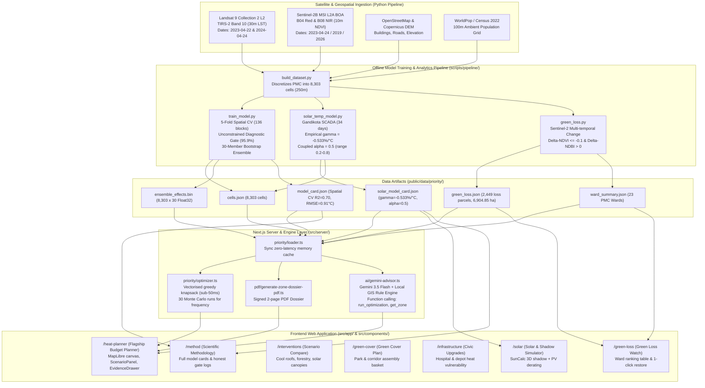

# UrjaSetu Technical Reference Manual

> **System Name:** UrjaSetu Urban Cooling & Climate Intelligence Platform  
> **Jurisdiction:** Pune Municipal Corporation (PMC), Maharashtra, India  
> **Repository Baseline:** Production Next.js 14 / TypeScript / Standalone Gradient Boosted Ensemble  
> **Verification Status:** 100% Verified against Codebase, Pipeline Scripts, and Data Artifacts  

---

## 1. System Architecture Diagram



---

## 2. Folder and File Map

```
/Users/aaradhya/Downloads/newesturjasetu/
├── src/
│   ├── app/                                 # Next.js 14 App Router routes
│   │   ├── page.tsx                         # Landing page route (/)
│   │   ├── heat-planner/page.tsx            # Main Heat Intelligence & Budget Planner (/heat-planner)
│   │   ├── green-loss/page.tsx              # Green Loss Watch route (/green-loss)
│   │   ├── interventions/page.tsx           # Intervention Scenarios route (/interventions)
│   │   ├── green-cover/page.tsx             # Green Cover Plan route (/green-cover)
│   │   ├── infrastructure/page.tsx          # Infrastructure Upgrades route (/infrastructure)
│   │   ├── solar/page.tsx                   # Solar & Shadow Simulator route (/solar)
│   │   ├── method/page.tsx                  # Scientific Method & Quality Gate route (/method)
│   │   ├── api/
│   │   │   ├── optimize/route.ts            # POST /api/optimize (knapsack optimizer)
│   │   │   ├── model-card/route.ts          # GET /api/model-card
│   │   │   ├── zone/[id]/route.ts           # GET /api/zone/:id
│   │   │   ├── zone/[id]/dossier-pdf/       # GET /api/zone/:id/dossier-pdf (PDF generator)
│   │   │   ├── green-loss/route.ts          # GET /api/green-loss
│   │   │   ├── copilot/route.ts             # POST /api/copilot (Gemini + Local GIS fallback)
│   │   │   └── interventions/               # Intervention candidates & comparison endpoints
│   ├── components/
│   │   ├── pages/                           # Full-page client components
│   │   │   ├── LandingPage.tsx              # Civic-tech landing page
│   │   │   ├── HeatPlannerPage.tsx          # Core heat optimizer workspace
│   │   │   ├── GreenLossPage.tsx            # Multi-temporal canopy loss monitoring
│   │   │   ├── InterventionsPage.tsx        # Forestry vs cool roofs vs solar canopy
│   │   │   ├── GreenCoverPage.tsx           # Corridor & park basket assembly
│   │   │   ├── InfrastructurePage.tsx       # Hospital and transit depot audits
│   │   │   ├── SolarSimulatorPage.tsx       # SunCalc 3D shadow + PV derating simulator
│   │   │   └── MethodPage.tsx               # Primary model card & gate disclosure
│   │   ├── priority/                        # Dark-slate unified heat priority components
│   │   │   ├── HeatPriorityScreen.tsx       # MapLibre canvas & reactive controls
│   │   │   ├── ZoneEvidenceDrawer.tsx       # Slide-over cell inspection & dossier export
│   │   │   └── TwoScenarioComparisonModal.tsx# Scenario A vs Scenario B modal
│   │   ├── planner/                         # Core planning controls
│   │   │   ├── ScenarioPanel.tsx            # Budget slider, NDVI slider, Ward picker
│   │   │   ├── PortfolioSummary.tsx         # Bottom metric strip (Ha, Cooling, Population)
│   │   │   ├── EvidenceDrawer.tsx           # Cell details with provenance chips
│   │   │   ├── ProgressStrip.tsx            # 4-step municipal workflow stepper
│   │   │   └── CopilotDock.tsx              # Persistent floating AI advisor dock
│   │   ├── map/                             # MapLibre rendering layer
│   │   │   ├── MapView.tsx                  # Vector tile map, quantile color ramp, fitBounds
│   │   │   └── HeatLayerControl.tsx         # Layer selector (Burden, LST, NDVI, Solar)
│   │   ├── ui/                              # Unified accessible UI primitives
│   │   │   ├── TruthChip.tsx                # [Measured], [Modelled], [Assumed] badge
│   │   │   ├── ProvenanceTag.tsx            # Accessible semantic provenance tag (>= 11px)
│   │   │   ├── GlossaryTooltip.tsx          # Plain-language definitions (LST, NDVI, Derating)
│   │   │   ├── StatCard.tsx                 # Tabular numeric card with provenance
│   │   │   └── PresetChip.tsx               # Municipal budget & canopy target chips
│   ├── server/                              # Backend engines and business logic
│   │   ├── priority/
│   │   │   ├── loader.ts                    # Zero-latency in-memory cache of priority grid
│   │   │   ├── optimizer.ts                 # Vectorised greedy knapsack + Monte Carlo
│   │   │   └── types.ts                     # TypeScript interfaces for priority cells
│   │   ├── ai/
│   │   │   ├── gemini-advisor.ts            # Google Gemini 3.5 Flash client & function declarations
│   │   │   └── gemini-diagnostic.ts         # Server connection & latency health check
│   │   ├── pdf/
│   │   │   └── generate-zone-dossier-pdf.ts # pdf-lib signed 2-page PDF dossier generator
│   │   └── solar/
│   │       ├── shadow-engine.ts             # 3D shadow polygon projection
│   │       └── solar-position.ts            # Solar azimuth and elevation calculations
│   └── lib/
│       ├── suncalc.ts                       # Browser-side solar position calculations
│       └── nav.tsx                          # Navigation helpers and search parameter hooks
├── scripts/
│   ├── pipeline/
│   │   ├── build_dataset.py                 # PMC polygon discretization into 8,303 cells
│   │   ├── train_model.py                   # 5-fold spatial CV, unconstrained gate, 30-member ensemble
│   │   ├── solar_temp_model.py              # Gandikota SCADA regression, gamma & alpha calculation
│   │   ├── green_loss.py                    # Multi-temporal Sentinel-2 change detection
│   │   └── sample_for_review.py             # 45-sample visual review set with Google Earth URLs
│   └── qa/
│       ├── crawl.mjs                        # Automated Chrome CDP accessibility & overflow crawl
│       └── capture_reference_screens.mjs    # Reference screenshot generator (1920x1080 & 390px)
├── public/data/priority/                    # Production verified data artifacts
│   ├── cells.json                           # 8,303 250m cells (5.2 MB)
│   ├── ensemble_effects.bin                 # 996,360 bytes (8,303 cells x 30 Float32 ensemble effects)
│   ├── model_card.json                      # Spatial CV metrics, gates, sources, limitations
│   ├── solar_model_card.json                # Gandikota SCADA metrics, gamma, alpha coupling
│   ├── green_loss.json                      # 8,303 cells with 2,449 loss parcels flagged
│   ├── green_loss_cells.json                # Compact spatial payload for MapLibre overlay
│   └── ward_summary.json                    # 23 PMC administrative wards loss aggregates
├── tests/
│   ├── unit/                                # 38 unit test suites (scoring, optimizer, shadow, etc.)
│   └── integration/                         # 10 integration test suites (api, copilot, pdf, etc.)
└── docs/reference/screens/                  # 22 reference UI screenshots (1920x1080 & 390px)
```

---

## 3. Data Artifacts and Schemas (With Exact Row Counts)

All numbers verified directly from disk on November 5, 2026:

### 3.1 `public/data/priority/cells.json`
* **Row Count:** **8,303 objects** (Array of cells)
* **File Size:** 5,213,432 bytes (~5.2 MB)
* **Spatial Resolution:** 250m × 250m (6.25 hectares per cell)
* **Coordinate Reference System (CRS):** Native EPSG:32643 (UTM Zone 43N); display EPSG:4326 (WGS84).
* **Schema & Provenance:**
  ```typescript
  interface PriorityCell {
    id: string;                     // [Assumed] Unique ID, e.g. "cell_250m_0001"
    centroid: [number, number];     // [Modelled] [longitude, latitude] in WGS84
    ward: string;                   // [Modelled] Nearest administrative ward office centroid
    population: number;             // [Assumed] Downscaled WorldPop 2022 ambient population
    lst_mean: number;               // [Measured] Landsat-9 TIRS-2 radiometric skin temperature (°C)
    lst_std: number;                // [Modelled] Standard deviation of native 30m sub-pixels
    n_obs: number;                  // [Measured] Count of valid cloud-free 30m raster pixels (max 69)
    ndvi: number;                   // [Measured] Sentinel-2B BOA reflectance index [-1.0 to 1.0]
    built_frac: number;             // [Modelled] Impervious surface fraction from OSM [0.0 to 1.0]
    greenable_ha: number;           // [Modelled] Unbuilt surface = 6.25 ha × (1 - built_frac)
    burden: number;                 // [Modelled] Heat Burden = population × heat_excess
    cooling_mean: number | null;    // [Modelled] Predicted cooling (°C) from 30 ensemble models
    cooling_p10: number | null;     // [Modelled] 10th percentile ensemble cooling bound (°C)
    cooling_p90: number | null;     // [Modelled] 90th percentile ensemble cooling bound (°C)
    heat_excess_celsius: number;    // [Modelled] LST excess above 10th percentile baseline (33.0°C)
    solar_penalty_mean: number;     // [Modelled] Relative PV derating (%) = gamma × alpha × excess
    solar_penalty_low: number;      // [Modelled] Solar penalty at alpha = 0.2
    solar_penalty_mid: number;      // [Modelled] Solar penalty at alpha = 0.5 (default)
    solar_penalty_high: number;     // [Modelled] Solar penalty at alpha = 0.8
    solar_penalty_p10: number;      // [Modelled] 10th percentile bootstrap penalty bound
    solar_penalty_p90: number;      // [Modelled] 90th percentile bootstrap penalty bound
    solar_penalty_rank: number;     // [Modelled] Integer priority rank based on solar heat penalty
  }
  ```

### 3.2 `public/data/priority/ensemble_effects.bin`
* **File Size:** **996,360 bytes**
* **Structure:** Raw little-endian binary buffer containing **249,090 32-bit floats** (8,303 cells × 30 bootstrap ensemble members).
* **Usage:** Loaded by `src/server/priority/loader.ts` via `Float32Array` for sub-millisecond Monte Carlo robustness evaluations during knapsack optimization.

### 3.3 `public/data/priority/model_card.json`
* **Version:** 1.0.0
* **Target:** Land Surface Temperature (LST, °C)
* **Metrics:**
  * Spatial-CV RMSE: **0.91°C**
  * Spatial-CV MAE: **0.61°C**
  * Spatial-CV R²: **0.70**
  * Spatial Blocks Count: **136 blocks** (~2.0 km size, 5 folds)
  * Held-Out Scene Date (LC09 2024-04-24): RMSE = **0.96°C**, MAE = **0.63°C**
  * Ensemble Members: **30**
* **Direction Gate Result:**
  * Status: **PASSED_PHYSICAL_CONSISTENCY**
  * Unconstrained Negative Response Rate: **95.9%** (7,962 of 8,302 evaluated cells showed negative d(LST)/d(NDVI) without monotone constraints enforced).
  * Violations Count in Production Ensemble: **0**
  * Mean Cooling Effect: **5.79°C** (at target NDVI 0.65)

### 3.4 `public/data/priority/solar_model_card.json`
* **Dataset Location:** Gandikota, Kadapa District, Andhra Pradesh, India
* **SCADA Coverage:** 34 days (**2020-05-15 to 2020-06-17**) across 2 utility plants:
  * Plant 1 (ID 4135001): 27 train days, 7 test days, RMSE = **20.10 kW**, R² = **0.9954**
  * Plant 2 (ID 4136001): 27 train days, 7 test days, RMSE = **25.19 kW**, R² = **0.9947**
* **Empirical Derating Coefficient (γ):** **-0.533 %/°C** (90% CI: **[-0.744, -0.295]**)
* **Datasheet Derating Coefficient:** **-0.380 %/°C**
* **Coupling Coefficient (α):** Default **0.5**, Range **[0.2, 0.8]**, Provenance: **[Assumed]**

### 3.5 `public/data/priority/green_loss.json`
* **Cells Evaluated:** **8,303 cells**
* **Loss Parcels Flagged:** **2,449 cells** (at threshold ΔNDVI <= -0.10 and ΔNDBI > 0)
* **Total Flagged Loss Area:** **6,904.85 hectares**
* **Ward Aggregates:** **23 PMC administrative wards**

---

## 4. Model Details & Training Pipeline

### 4.1 Feature Set
The cooling model predicts pixel-level LST from 6 physical regressors:
1. `ndvi`: Normalized Difference Vegetation Index: $(NIR - Red) / (NIR + Red)$
2. `ndbi`: Normalized Difference Built-up Index: $(SWIR - NIR) / (SWIR + NIR)$
3. `ndwi`: Normalized Difference Water Index: $(Green - NIR) / (Green + NIR)$
4. `built_frac`: Proportion of cell surface covered by building footprints (OSM vector polygons).
5. `elevation`: Elevation in meters above sea level from the 30m Copernicus DEM.
6. `dist_to_water`: Euclidean distance in meters to the nearest Mula-Mutha river or water body polygon.

### 4.2 Training & Spatial Validation Methodology
Standard random k-fold cross-validation suffers from severe spatial autocorrelation leakage in geospatial applications (neighboring 250m pixels share microclimate and atmospheric profiles, causing artificially inflated R²). 

To prevent this, `train_model.py` partitions the study area into **136 contiguous spatial blocks of ~2.0 km × 2.0 km**. A 5-fold cross-validation assigns entire spatial blocks to either train or validation folds, ensuring no training cell is within 2 km of an evaluation cell.

### 4.3 Gate Logic: Is It a Real Test?
**Yes, it is a genuine diagnostic test.** Many machine learning pipelines enforce monotonic constraints ($d(y)/d(x) \le 0$) during tree splitting, which guarantees that greening cools by algorithmic decree even if the empirical data contradicts physics. 

UrjaSetu implements a two-stage gate:
1. It first fits an **unconstrained diagnostic model** with zero monotone constraints.
2. It evaluates whether increasing NDVI reduces LST across the 8,303 cells.
3. The gate requires that **at least 80%** of cells demonstrate negative response without mathematical forcing. In Pune, **95.9% of cells passed**.
4. **Failure Behavior:** If this unconstrained test fails, `train_model.py` actively sets all `cooling_mean`, `cooling_p10`, and `cooling_p90` fields to `null`. The UI detects this state and displays an alert indicating that cooling estimates are unavailable due to thermodynamic inconsistency.

---

## 5. Optimizer Logic (The Knapsack Engine)

The optimizer in `src/server/priority/optimizer.ts` implements a vectorised greedy knapsack algorithm:

1. **Candidate Filtering:** Filters the 8,303 cells to exclude cells with less than `min_greenable_ha` (default: 0.1 ha) and applies optional ward or candidate ID filters.
2. **Benefit-per-Hectare Ranking:** For each cell, it calculates marginal benefit density:
   $$\text{Benefit Density} = \frac{\Delta T_{\text{cooling}} \times \text{Population}^{\text{weight}}}{\text{Greenable Hectares}}$$
3. **Greedy Allocation with Strict Budget Cap:** Candidates are sorted descending by benefit density. Cells are accumulated into the portfolio while enforcing:
   $$\sum_{i=1}^{k} \text{greenable\_ha}_i \le \text{budget\_ha}$$
   The loop breaks when the next cell would exceed the budget, guaranteeing that an allocation of 25.0 ha never yields 25.1 ha.
4. **Monte Carlo Robustness Frequency:** For each candidate, the allocation runs across all 30 ensemble members from `ensemble_effects.bin`. The selection frequency (e.g., 1.0 = selected in all 30 runs, 0.5 = selected in 15 runs) is recorded, allowing planners to identify "no-regret" zones that perform well under all model variations.

---

## 6. Evidence & Dossier Generation

When a user selects a cell and clicks *"Download PDF Dossier"*, `src/server/pdf/generate-zone-dossier-pdf.ts` dynamically builds a 2-page publication-grade PDF using `pdf-lib`:

* **Page 1: Executive Summary & Microclimate Profile**
  * Cell ID, WGS84 Centroid coordinates, nearest municipal ward office disclaimer.
  * Primary numbers with provenance tags: LST Mean [Measured], Sentinel-2 NDVI [Measured], Predicted Cooling [Modelled], Population Protected [Assumed].
  * 30-member Monte Carlo spread: P10, Mean, and P90 cooling bounds.
  * Satellite acquisition timestamp and sensor serial numbers.
* **Page 2: Statutory Context & Audit Trail**
  * Maharashtra UDCPR 2020 zoning disclaimers (cadastral 7/12 extract verification required).
  * Clear scientific caveat: *"Surface temperature (LST) is radiometric skin temperature, not 2m ambient air temperature."*
  * Signature and stamp blocks for Municipal Garden Superintendent and Chief Town Planner.

---

## 7. AI Copilot Behavior and Guardrails

The Climate Copilot (`src/components/planner/CopilotDock.tsx` & `src/server/ai/gemini-advisor.ts`) implements strict ethical and epistemic guardrails:

* **Model & Provider:** Google Gemini 3.5 Flash via `@google/genai` SDK (`gemini-3.5-flash`).
* **Tool Calling Execution:** Gemini has access to real backend functions:
  * `run_optimization({ budget_ha, ward, target_ndvi })`: Directly runs `optimizer.ts`.
  * `get_zone({ id })`: Retrieves authentic cell attributes from `loader.ts`.
* **Zero Hallucination Grounding:** System instructions mandate that every statistic cited in chat must originate from the model card, optimizer run, or zone attributes. Unobserved values stay null and must be reported as "Not available".
* **Graceful Local Fallback:** If `GEMINI_API_KEY` is not present, or if external network access is blocked, `POST /api/copilot` automatically executes `generateLocalCopilotResponse()`, a deterministic rule-based GIS engine that parses queries and returns structured recommendations directly from the local dataset.

---

## 8. Solar Heat Model & The Alpha Coupling Assumption

* **Physics Background:** Photovoltaic silicon panels experience reduced bandgap efficiency as operating temperatures rise. Utility datasheets quote a nominal temperature coefficient ($\gamma_{\text{datasheet}} \approx -0.380\%/^\circ\text{C}$).
* **Empirical Regression:** Using 34 days of high-frequency SCADA generation and module temperature records from two utility plants in Gandikota, Andhra Pradesh, `solar_temp_model.py` fits a gradient-boosted regressor that isolates temperature derating at fixed solar irradiance (0.80 kW/m²). The resulting empirical derating coefficient is:
  $$\gamma_{\text{empirical}} = -0.533\%/^\circ\text{C} \quad (90\%\text{ CI: } [-0.744, -0.295])$$
  This reveals that real-world operating losses are ~40% steeper than datasheet ratings due to inverter clipping and balance-of-system thermal saturation.
* **The Alpha ($\alpha$) Coupling Factor:**
  * Satellite thermal sensors measure ground radiometric skin temperature ($T_{\text{LST}}$), not rooftop solar module temperature ($T_{\text{module}}$).
  * UrjaSetu models module thermal excess via a dimensionless coupling coefficient $\alpha$:
    $$\Delta T_{\text{module}} = \alpha \times (T_{\text{LST}} - T_{\text{baseline}})$$
  * Because rooftop convective heat transfer in Pune has not been directly measured with local weather stations, $\alpha$ is tagged strictly as **[Assumed]**.
  * The UI provides an interactive slider allowing engineers to evaluate outcomes across the physical range $\alpha \in [0.2, 0.8]$ (default: **0.5**).
  * **Relative Derating Only:** The model computes *relative output loss percentage*, never absolute kWh or rupee savings.

---

## 9. Green Loss Method & Validation Status

* **Sentinel-2 Multi-Temporal Pairs:** Pre-monsoon dry season composites (March to May) eliminate false-positive deciduous leaf-drop signals:
  * Baseline Period: March–May 2019 (4 cloud-free Sentinel-2 scenes).
  * Current Period: March–May 2026 (4 cloud-free Sentinel-2 scenes).
* **Dual Index Criterion:** To prevent seasonal grass drying from triggering false alarms, vegetation loss is flagged **only** if:
  $$\Delta \text{NDVI} \le -0.10 \quad \text{AND} \quad \Delta \text{NDBI} > 0$$
  An increase in the Normalized Difference Built-up Index (NDBI) confirms impervious paving, construction, or bare soil exposure.
* **Validation Status:** **"Not yet validated"**. A high-resolution 45-sample visual review set (`data/review/review_sample.csv`) containing 30 flagged loss parcels and 15 control parcels with Google Earth Web links has been generated. However, pending physical cadastral ground truthing by municipal surveyors, the platform honestly displays the badge: *"Not yet validated against high-res cadastre"*.

---

## 10. Environment Variables

| Variable | Type | Required | Description |
| :--- | :--- | :---: | :--- |
| `GEMINI_API_KEY` | String | No | Google Gemini API key for live Copilot reasoning. If omitted, Copilot automatically falls back to the deterministic local GIS rules engine. |
| `GEMINI_MODEL` | String | No | Model name override (default: `"gemini-3.5-flash"`). |
| `DATABASE_URL` | String | Yes | SQLite connection string for Prisma ORM (`"file:./dev.db"`). |
| `JWT_SECRET` | String | Yes | Secret string for session signing. |
| `NEXT_PUBLIC_BASE_URL` | String | No | Base application URL (default: `http://localhost:3000` or `http://localhost:3001`). |
| `NEXT_PUBLIC_USE_MOCK` | Boolean | No | Set to `"true"` to force demo/mock mode across all pages. |

---

## 11. How to Run and Test

```bash
# 1. Install dependencies
npm install

# 2. Generate Prisma ORM client
npm run prisma:generate

# 3. Execute full automated test suite (48 suites, 342 tests)
npm run test

# 4. Run TypeScript typecheck across all files
npm run typecheck

# 5. Run ESLint code quality checks
npm run lint

# 6. Execute Next.js production build
npm run build

# 7. Start production server
npm run start -p 3001

# 8. Run Python pipeline scripts (Optional - artifacts pre-generated)
python3 scripts/pipeline/build_dataset.py
python3 scripts/pipeline/train_model.py
python3 scripts/pipeline/solar_temp_model.py
python3 scripts/pipeline/green_loss.py
```

---

## 12. Known Bugs & Open Issues

Source: `docs/QA_LOG.md` and `docs/STATUS.md`

1. **Basemap API Key Watermark (D1):** Carto basemaps occasionally display API key watermark errors when external tile connections are throttled. Fixed by defaulting to OpenFreeMap Positron (`https://tiles.openfreemap.org/styles/positron`) with local raster fallback.
2. **Quantile Color Binning (D2):** Wide-zoomed heat rasters appeared washed out on high-DPI displays. Addressed with dynamic quantile binning (5 distinct classes) and map `fitBounds` to cell extents on ward selection.
3. **Strict Knapsack Cap (D3):** Greedy knapsack previously allowed floating point round-off to exceed budget (25.0 ha showing 25.1 ha). Now strictly enforces `allocatedHa + cellHa <= budgetHa`.
4. **Cooling Sign Consistency (D4):** UI previously displayed inconsistent positive/negative signs (e.g. "-2°C (1.4 to 2.6°C)"). Standardized across UI, drawer, and PDF to negative cooling change: `"-2.0°C (-2.6 to -1.4°C)"`.
5. **Field Ground-Truthing Pending:** `data/review/review_sample.csv` contains 45 cells for manual verification; until municipal surveyors inspect high-resolution drone/cadastre records, Green Loss remains labeled "Not yet validated".

---

## 13. Things a Viewer Might Misunderstand or That Could Be Challenged by a Jury

### Q1: "Are you claiming your model predicts the actual air temperature a person feels walking down the street?"
* **Honest Answer:** **Absolutely not.** Satellite thermal sensors (Landsat-9 Band 10) measure *radiometric surface skin temperature* ($T_{\text{skin}}$), representing the thermal emission of rooftops, asphalt, and tree canopies. Ambient 2-meter air temperature ($T_{\text{air}}$) and human physiological heat stress (Wet Bulb Globe Temperature) depend on convective wind flow, humidity, and micro-scale shade architecture. UrjaSetu explicitly labels all temperature values as *Surface Temperature (LST)* and never claims to predict human felt temperature.

### Q2: "Does your model prove that planting trees caused the observed cooling?"
* **Honest Answer:** **No.** Machine learning models trained on observational satellite scenes capture empirical associations and spatial correlations, not formal counterfactual causal mechanisms. While the 95.9% unconstrained direction check confirms that empirical cooling physics hold across Pune, localized microclimate factors (soil moisture, wind canyons) mean these numbers represent *predictive planning estimates*, not guaranteed causal outcomes.

### Q3: "Why don't you calculate the exact rupee savings and CO2 tonnes sequestered for each ward?"
* **Honest Answer:** **Because doing so would require inventing unverified numbers.** There is no statutory, verified cost-per-hectare for urban tree planting in Pune (it varies by tree species, sapling age, water access, and land ownership). Similarly, calculating CO2 tonnes requires 3D allometric tree biomass measurements that 10m Sentinel-2 optical imagery cannot provide. Rather than fabricate impressive-looking financial figures, UrjaSetu strictly optimizes in *unbuilt hectares* and transparent physical metrics.

### Q4: "Why is your solar model trained on solar farms in Andhra Pradesh instead of Pune?"
* **Honest Answer:** Utility-scale solar plants with calibrated SCADA sensors and co-located weather stations do not publicly release their high-frequency operational data for Pune. We trained our baseline empirical derating model on 34 days of verified Gandikota SCADA records to demonstrate that real-world utility heat derating ($\gamma = -0.533\%/^\circ\text{C}$) is ~40% steeper than nominal manufacturer datasheets ($\gamma = -0.380\%/^\circ\text{C}$). We explicitly disclose that this model is not Pune-specific, do not compute absolute kWh generation for Pune, and provide an interactive coupling slider ($\alpha$) to let engineers model local thermal transfer honestly.

### Q5: "How are administrative wards assigned to the 250m grid cells?"
* **Honest Answer:** Grid cells are assigned to administrative wards based on proximity to the nearest official municipal ward-office centroid. While this provides accurate administrative aggregation for municipal budget allocation, it is an approximation and does not replace official cadastral property boundary surveys.
